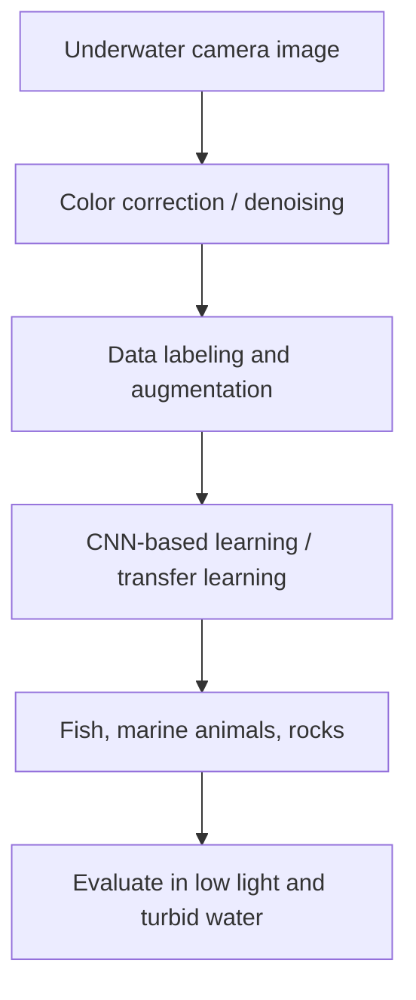

# Object Detection Under Water

> **Status:** Documented research proposal / Phase I synopsis. The submitted material does not establish that a runnable model, trained weights, evaluation dataset, robot, or deployed inference system is available in this repository. This is a technical case study, **not** a verified working implementation.

## The challenge

Underwater images can be difficult to analyze because of water turbidity, light scattering, uneven illumination, noise and complex backgrounds. The project explores a computer-vision pipeline for identifying **fish, other marine animals and rocks** under these conditions. The intended applications include marine biodiversity research, environmental monitoring and underwater exploration.

## Proposed approach

1. **Capture** underwater imagery using an underwater camera.
2. **Enhance** captured frames with color correction, denoising and contrast enhancement.
3. **Prepare data** with labels and augmentation to improve model robustness.
4. **Learn visual patterns** with a convolutional neural network (CNN), potentially using transfer learning.
5. **Detect or classify** objects such as fish, marine animals and rocks.
6. **Validate** performance in varied lighting, turbidity, camera distance and background conditions.
7. **Explore real-time integration** with an underwater robot, a base station and wireless transmission as described in the proposed system.

These are **project objectives and design steps** from the synopsis—not proof that each stage has already been implemented.

## Conceptual processing flow

## Detailed project explanation

The supplied project notes describe a pipeline involving **underwater image acquisition, OpenCV color correction and denoising, a CNN classifier and image-level predictions**. The walkthrough discusses labeled fish/human/rock examples, a sample 70/15/15 dataset split and potential YOLO-based detection as future work. These details are **reported in the project notes**, not independently reproduced from runnable code.

See the [**full project workflow, CNN explanation and key challenges**](docs/DETAILED_PROJECT_EXPLANATION.md).

## Technologies considered

| Area | Methods / technology discussed |
| --- | --- |
| Language & image processing | Python, OpenCV |
| Learning | Convolutional neural networks; TensorFlow / PyTorch as options |
| Preprocessing | Color correction, denoising, contrast enhancement |
| Generalization | Data augmentation, transfer learning |
| Potential detection architectures | YOLO, Faster R-CNN, U-Net (listed as possibilities, not confirmed implementations) |
| Proposed hardware | Underwater camera, protective housing, Raspberry Pi / base-station integration |

## Portfolio deliverables

- [Technical methodology](docs/TECHNICAL_METHODOLOGY.md)
- [Evaluation plan and project status](docs/EVALUATION_AND_STATUS.md)
- Academic Phase I synopsis (original academic document; not reproduced here)

No training code, original dataset, model weights or runnable demo have been supplied for publication. These can be added if available and cleared for release.

## Important distinction

Results mentioned in the literature survey refer to **other published research**, not benchmark results obtained by this project. Until implementation and measurements are shared, do not claim a tested accuracy, faster processing, or deployment as a finished product.
