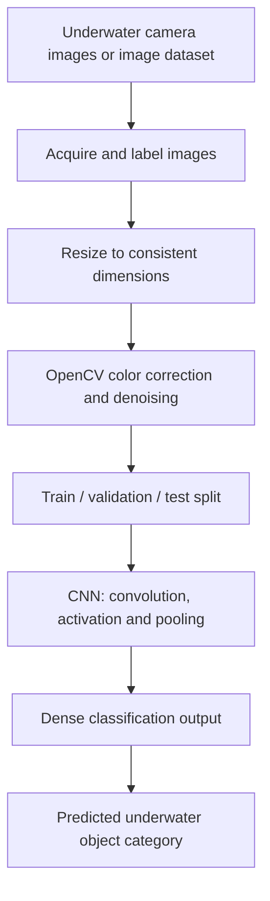

# Underwater Object Detection — Detailed Project Explanation

This technical explanation is adapted from the supplied **10-page `object(1).pdf` project/interview notes**. It follows the terminology and workflow described in that document. The PDF is an explanatory account written in the first person, not an executable code package or evaluation report.

## 1. Project overview

The notes describe an AI-based underwater-image analysis project using **Python, OpenCV and convolutional neural networks (CNNs)**. Its goal is to identify underwater objects despite reduced visibility caused by poor illumination, scattering, color distortion, suspended particles and blur.

The document uses the name **“Underwater Object Detection System.”** Importantly, its detailed implementation explanation says the CNN **classifies the whole input image**, rather than localizing objects with bounding boxes. A detector such as YOLO is discussed as a possible future extension.

The introductory examples mention **fish, coral and rocks**. The later dataset and implementation walkthrough specifically describes the labeled classes as **fish, human and rock**. Both descriptions appear in the supplied notes; the precise final class set should be confirmed from the original dataset and model files.

## 2. Workflow described in the notes



### Image acquisition and preparation

Input may come from an underwater camera, video frames or saved images. In the later account, the author describes collecting labeled images from **Kaggle**. The notes illustrate arranging example data by class in `Fish/`, `Human/` and `Rock/` folders.

All images are resized to a common shape for CNN input. **224 × 224 pixels** is supplied as an *example*, not an independently confirmed training parameter. The described goal is to ensure that all samples have consistent input dimensions.

### Enhancement with OpenCV

Underwater images can exhibit color loss, low contrast and noise. The notes describe using OpenCV to:

- **Correct color** to compensate for underwater color casts.
- **Denoise** images affected by particles and sensor noise.
- Consider **Gaussian blur or median filtering** for noise reduction.
- Improve the visibility of objects so image features are easier to distinguish.

The document reports preprocessing as a major part of the project. It does not provide before/after benchmark images or independently measured improvement figures.

### Dataset preparation and splitting

The later walkthrough describes **70% training, 15% validation and 15% testing** as the intended split. The “1,000 images” illustration in the notes is an example calculation; it is **not** evidence of the actual dataset size.

A reproducible experiment would need the exact Kaggle source, class counts, preprocessing scripts, the actual split and random seed.

### CNN classification

The PDF outlines the following illustrative network stages:

```text
Input image
    ↓
Convolution layers
    ↓
ReLU activations
    ↓
Pooling
    ↓
Flatten
    ↓
Dense layers
    ↓
Class prediction (e.g., fish / human / rock)
```

The network is described as learning spatial features such as edges, shapes, patterns and textures rather than depending entirely on manually designed rules. Specific layer dimensions, model weights, training logs and hyperparameters have not been provided.

## 3. Classification versus object detection

**What the PDF describes for the current implementation:** Image-level CNN **classification**—for example, taking an underwater image and returning a label such as “Fish” or “Rock.”

**Suggested future improvement:** Bounding-box object **detection** using a model such as YOLO. Object localization is not shown or established by this PDF.

## 4. Main challenge described

The PDF identifies **poor underwater image quality** as the major obstacle. Low visibility, missing natural colors and particulate noise were reported to make image interpretation harder. The author describes applying color correction and denoising to improve visual clarity before CNN classification.

Claims that processing **increased classification accuracy** are qualitative in these notes: no test table, accuracy percentage, experiment log or confusion matrix was supplied to independently quantify that improvement.

## 5. Applications mentioned

- Marine-life and biodiversity research
- Environmental monitoring
- Underwater surveillance and inspection
- Search and rescue
- Underwater robotic exploration
- Aquaculture monitoring

These are possible **applications**, not deployments demonstrated in the supplied document.

## 6. Future enhancements proposed

The document suggests using a real-time model such as **YOLO**, collecting larger and more varied datasets, recognizing additional underwater species, and considering deployment on underwater drones.

## 7. Evidence and publication status

The submitted PDF contains an explanatory interview-style walkthrough. It **reports** image collection, OpenCV preprocessing, dataset preparation, CNN training and classification, but does not include:

- Runnable Python scripts or a notebook
- Downloadable dataset or training annotations
- Saved CNN model / learned weights
- Class-by-class metrics or confusion matrix
- A working inference demo or underwater-robot test

Accordingly, these steps are presented as **reported project work**, not independently verified implementation results. The repository remains a documentation-led portfolio project until executable artifacts and measured outcomes are provided.

## Source

Adapted from `object(1).pdf`, **10 pages**, provided for this project. This is a technical summary of that document—not a verbatim publication of the interview questions.
